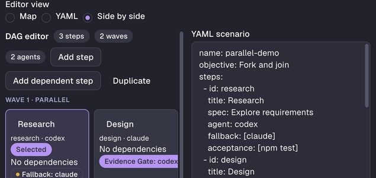
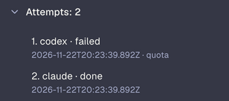
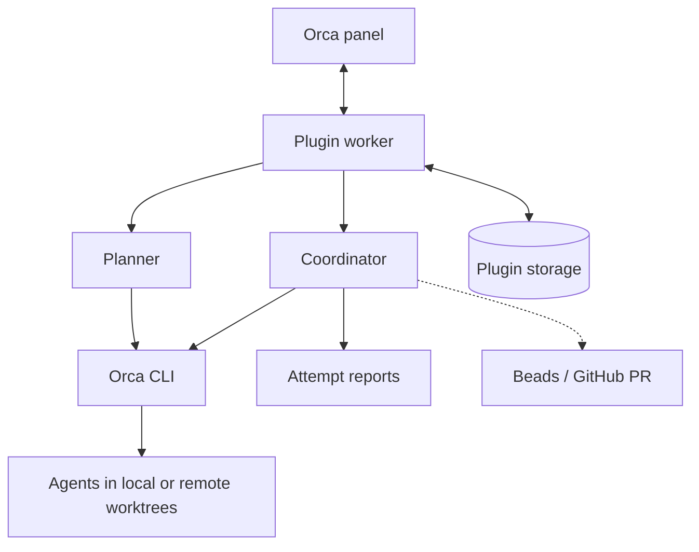

# Agent Pipeline

[English](README.md) · [Русский](README.ru.md) · [简体中文](README.zh-CN.md)

Agent Pipeline lets you give a coding task to one agent in Orca and have another check the result. For example, Codex can fix a CSV export bug and run the tests. Claude then reads the diff, reruns the checks and reports what it found. You can watch both steps in the same panel and save the workflow as YAML for the next bug.



## What you can do

- **Plan a change.** Give Planner a goal and an agent will draft a YAML scenario. Edit the steps on the map, preview which ones can run together, and save the scenario in the repository for your team.
- **Split work across agents.** Choose a host and Git worktree for each step. Research and design can run in parallel, while implementation waits for both. Limit how many agents run at once, overall or by provider and host.
- **Decide what can move forward.** Give a second agent the diff and acceptance checks, or ask a person to approve a step. A release scenario can also open a GitHub pull request, wait for its checks and request approval to merge.
- **Find out what happened.** Open **Runs** for a step’s attempt history, latest output and acceptance commands. Use **Metrics** to compare attempts by agent, or **Beads** to claim, close and reopen linked issues if your project uses Beads.

## Install

Install with the CLI included in Orca **1.4.248 or later**.

```sh
orca plugin install Alexander-64/orca-pipeline@v0.1.2 --json
```

Orca will show the permissions and a command containing `--approve <fingerprint>`. Review them before running that command. Agent Pipeline runs as a trusted Node.js worker under your account, with access to your files, the network and external programs. Through Orca it lists agents and workspaces, opens coordinator terminals and stores its settings and run history.

Sign in to the agent CLIs you plan to use on each execution host. For the Beads board, install `bd` on the machine running the coordinator and run `bd init` in your project. If Orca can’t find it, set the full path under **Settings → Plugins → Agent Pipeline → Beads CLI executable**.

## Try a change and a review

1. Open **Agent Pipeline → Scenario**, select your workspace and choose the **Implementation → Evidence Gate** template.
2. Select the implementation step and give it a concrete task, such as “Fix CSV export so a comma inside a quoted field stays in that field.” Set the acceptance command to the test command your project actually uses. Choose the implementing agent and a different review agent, then click **Apply step**.
3. Open **Run preview** to see who will do the work, in which worktree, and what each agent will check. Click **Start** when the plan looks right.
4. In **Runs**, select a step to see its attempts and output. The reviewer can accept the change, request a fix and another review, or report a blocker.

The map and YAML editor share one draft. To reuse it, open **Repository scenarios**, enter a name such as `csv-export.yaml`, and click **Save file**. The file goes in the selected workspace’s `pipelines/` directory on the coordinator host. To edit one that’s already in Git, choose **Browse pipelines/** and **Open file**. If the file changes on disk while you’re editing, reopen it before saving.

## When an agent hits its limit

If a step has fallback agents and Orca confirms that the current attempt ended on a quota limit, the coordinator can pass the work to the next eligible agent. The next agent receives a checkpoint with the previous attempt’s output and the checks it still needs to verify.



In the simulated run above, Claude finishes the release notes after Codex hits its limit. Kimi then reviews the change. You can reproduce the handoff locally and read the checkpoint. [Run the failover demo](examples/failover/README.md)

## For a larger workflow

In YAML, `needs` sets the order of steps. Independent steps can run in parallel, subject to the limits you set for agents and hosts. Use `reviewAgent` to add an independent review, or `approval` to pause a step for a human decision. The release workflow in this repository shows how to test a Git commit, review it, and ask for approval before pushing its tag. [Read the release scenario](pipelines/release.yaml)

<details>
<summary>Example YAML</summary>

```yaml
name: add-export
objective: Add export and verify it with tests
steps:
  - id: implement
    title: Implementation
    spec: Implement the change in the current workspace
    agent: codex
    fallback: [claude, kimi]
    placement:
      host: local
      worktree: current
    acceptance:
      - npm test
  - id: review
    title: Independent review
    needs: [implement]
    spec: Review the diff and rerun the tests
    agent: claude
    placement:
      host: local
      worktree: current
    acceptance:
      - npm test
```

Replace the agent IDs and test commands with ones available in your project. For a remote step, set `placement.host` to a saved Orca environment. Use an exact worktree selector, or choose `new-child` or `new-top-level` and set `placement.repo`.

</details>

## Architecture

The Orca panel owns the draft you are editing. When you click **Start**, it sends the YAML and workspace ID to the plugin’s Node.js worker. The worker validates the scenario, opens a coordinator terminal and hands a snapshot to the coordinator. Later edits apply to the next run.



The **Planner** uses an Orca agent to produce a draft. The **Coordinator** creates tasks with dependencies, polls Orca for their status and dispatches ready work. Both use the same CLI client. The worker sends plan and run updates back to the panel. [Panel](src/panel.tsx) · [Worker](src/worker.ts) · [Planner](src/planner.ts) · [Coordinator](src/coordinator.ts) · [Orca client](src/cli.ts)

Orca’s plugin storage keeps plans and run history across restarts. When an attempt ends, the coordinator writes a JSON report in the coordinator workspace under `.agent-pipeline/artifacts/<runId>/`, with the agent, its status, output and any reported file changes. Scenarios you save for reuse live separately in `pipelines/`. [Attempt reports](src/artifacts.ts) · [Scenario files](src/scenarioFiles.ts)

<details>
<summary>Development and release checks</summary>

Use Node.js 22+ and the Orca CLI. Run these commands from a clean checkout.

```sh
npm ci
orca plugin types . --json
npm run typecheck
npm test
npm run test:release
npm run check
npm run validate
```

Use watch mode to reload the panel as you edit it.

```sh
orca plugin dev watch . --check --shot .orca/shots --json
```

To check the files that will ship, build into a fresh directory and validate it.

```sh
npm run build:release -- --out .release-smoke
orca plugin validate .release-smoke --json
```

The default build replaces `dist/agent-pipeline`. Choose a fresh `--out` path if a running plugin uses that directory. The release includes the YAML runtime and its upstream license. For workflows that create pull requests, sign in to `gh` on the coordinator host. Live quota checks for Codex use `codex app-server`.

</details>

[Orca Community listing](https://orca.dev/plugins/alexander-64/orca-pipeline) · [MIT license](LICENSE)
