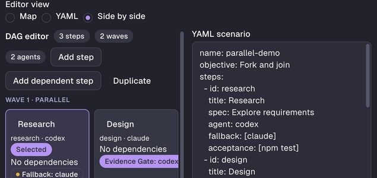
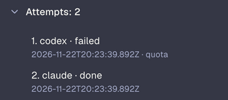

# Agent Pipeline

[English](README.md) · [Русский](README.ru.md) · [简体中文](README.zh-CN.md)

С Agent Pipeline в Orca можно поручить одному агенту исправить ошибку, а другому проверить результат. Например, Codex чинит экспорт в CSV и запускает тесты. Затем Claude читает изменения, повторяет проверки и пишет, что нашёл. За обоими шагами можно следить в одной панели, а сам сценарий сохранить в YAML и использовать в следующей задаче.



## Установка

Понадобится Orca **1.4.248 или новее**. Установите плагин из терминала.

```sh
orca plugin install Alexander-64/orca-pipeline@v0.1.2 --json
```

Orca покажет разрешения и команду с `--approve <fingerprint>`. Проверьте список, прежде чем подтверждать установку. Плагин работает от вашего имени в отдельном процессе Node.js. У него есть доступ к файлам, сети и внешним программам. Через Orca он получает список агентов и рабочих пространств, открывает терминалы координатора, хранит настройки и историю запусков.

На каждой машине, где будут работать агенты, войдите в их учётные записи через соответствующие CLI. Для доски Beads установите `bd` на машине координатора и выполните `bd init` в своём проекте. Если Orca не находит `bd`, укажите полный путь в **Settings → Plugins → Agent Pipeline → Beads CLI executable**.

## Первый запуск

1. Откройте **Agent Pipeline → Scenario**, выберите рабочее пространство и шаблон **Implementation → Evidence Gate**.
2. Выберите на карте шаг реализации и опишите задачу. Например, «Исправь экспорт в CSV так, чтобы запятая внутри поля в кавычках оставалась частью поля». Укажите команду, которой вы проверяете такие изменения в своём проекте. Выберите исполнителя и другого агента для ревью. Нажмите **Apply step**.
3. Откройте **Run preview**. Здесь видно, кто возьмёт каждый шаг, в какой рабочей копии Git он будет работать и что ему предстоит проверить. Если всё верно, нажмите **Start**.
4. Во вкладке **Runs** выберите шаг, чтобы увидеть попытки и прочитать вывод агента. По итогам ревью агент может принять изменение, запросить исправление с повторной проверкой или объяснить, что мешает продолжить.

Карту и YAML можно редактировать рядом. Чтобы сохранить сценарий, откройте **Repository scenarios**, введите имя, например `csv-export.yaml`, и нажмите **Save file**. Файл появится в каталоге `pipelines/` выбранного проекта на машине координатора. Если сценарий уже лежит в Git, выберите его через **Browse pipelines/** и нажмите **Open file**. Если за время работы файл изменился на диске, панель попросит открыть его заново.

## Если у агента закончилась квота

Для шага можно назначить запасных агентов. Когда Orca подтвердит, что попытка завершилась из-за исчерпанной квоты, координатор сможет передать задачу следующему агенту из списка. Тот получит вывод предыдущей попытки и список проверок, которые ещё нужно подтвердить.



На скриншоте показан учебный запуск. Codex начал править заметки к релизу, Claude закончил, а Kimi проверил изменения. Пример можно запустить локально и посмотреть, что именно получил Claude при передаче работы. [Инструкция к примеру](examples/failover/README.md)

## Когда шагов несколько

В YAML поле `needs` задаёт, какие шаги должны завершиться раньше других. Независимые шаги могут идти параллельно с учётом заданных лимитов. Поле `reviewAgent` добавляет независимое ревью, а `approval` позволяет дождаться решения человека. В сценарии релиза из этого репозитория агенты проверяют конкретный коммит и запрашивают разрешение перед отправкой тега на GitHub. [Сценарий релиза](pipelines/release.yaml)

<details>
<summary>Пример YAML</summary>

```yaml
name: add-export
objective: Добавить экспорт и проверить его тестами
steps:
  - id: implement
    title: Реализация
    spec: Внести изменение в рабочую копию проекта
    agent: codex
    fallback: [claude, kimi]
    placement:
      host: local
      worktree: current
    acceptance:
      - npm test
  - id: review
    title: Независимая проверка
    needs: [implement]
    spec: Проверить изменения и повторно запустить тесты
    agent: claude
    placement:
      host: local
      worktree: current
    acceptance:
      - npm test
```

Подставьте агентов и команды, доступные в вашем проекте. Для удалённого шага укажите в `placement.host` имя сохранённого окружения Orca. Рабочую копию можно указать точным селектором или создать через `new-child` либо `new-top-level`, задав `placement.repo`.

</details>

<details>
<summary>Разработка и проверка сборки</summary>

Понадобятся Node.js 22+ и Orca CLI. Запустите проверки из свежей копии репозитория.

```sh
npm ci
orca plugin types . --json
npm run typecheck
npm test
npm run test:release
npm run check
npm run validate
```

Чтобы панель обновлялась при редактировании, запустите Orca в режиме наблюдения.

```sh
orca plugin dev watch . --check --shot .orca/shots --json
```

Для проверки поставки соберите плагин в новый каталог и запустите валидатор.

```sh
npm run build:release -- --out .release-smoke
orca plugin validate .release-smoke --json
```

По умолчанию сборщик заменяет `dist/agent-pipeline`. Если оттуда работает плагин, укажите новый каталог через `--out`. В поставку входят библиотека YAML и её лицензия. Для работы с pull request нужна авторизация в `gh` на машине координатора. Для чтения квоты Codex используется `codex app-server`.

</details>

[Страница в Orca Community](https://orca.dev/plugins/alexander-64/orca-pipeline) · [Лицензия MIT](LICENSE)
