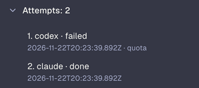
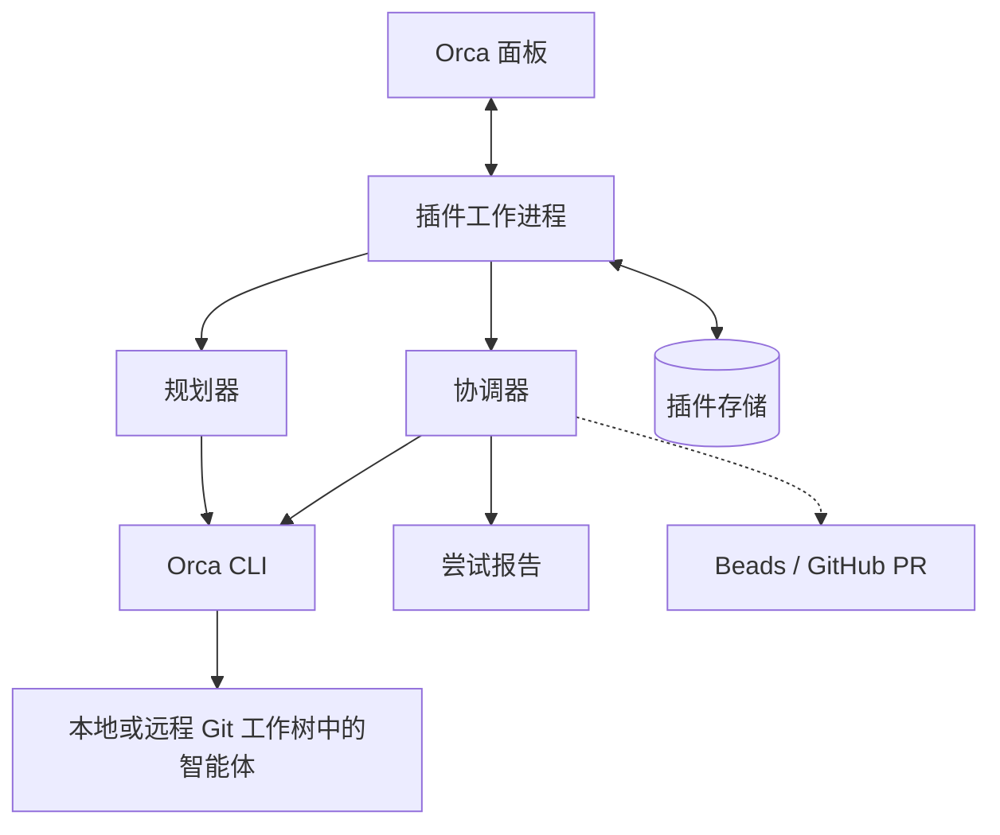

# Agent Pipeline

[English](README.md) · [Русский](README.ru.md) · [简体中文](README.zh-CN.md)

Agent Pipeline 是一个 Orca 插件，可以让多个智能体按依赖顺序协作。例如，让 Codex 改代码并跑测试，再由 Claude 审查改动。你可以在图形编辑器或 YAML 中定义步骤，也可以把目标交给 Planner 生成草稿。有些步骤可以并行执行，也可以在发布前要求人工审批。


## 可以用它做什么

- **把目标写成计划。** 在 Planner 中描述目标，让选定的智能体起草 YAML。你可以在图上调整步骤、预览哪些任务可以并行，再把场景存进仓库供团队复用。
- **分配任务。** 为每一步指定智能体、主机和 Git 工作树。例如，调研和设计可以同时进行，实现步骤等两者完成后再开始。并发数可以按整个运行、模型提供商或主机分别限制。
- **决定何时放行。** 让另一位智能体审查改动并重复验收检查，或让指定步骤等待人工批准。发布场景还可以创建 GitHub 拉取请求，等待检查完成，再请求批准合并。
- **查看执行记录。** 在 **Runs** 中查看每一步的尝试记录、最近一次输出和验收命令。在 **Metrics** 中比较不同智能体的尝试次数。如果项目使用 Beads，还可以在 **Beads** 中认领、关闭或重新打开关联任务。

## 安装

需要 Orca **1.4.248 或更高版本**，并确保终端能调用 `orca`。

```sh
orca plugin install Alexander-64/orca-pipeline@v0.1.3 --json
```

安装时，Orca 会列出插件申请的权限。确认后，运行提示中带 `--approve <fingerprint>` 的命令。插件需要读取智能体和工作区、启动协调器终端、读取插件设置，以及保存计划、运行记录和日志。插件以 `trusted-worker` 模式运行，Node 进程拥有当前用户的文件、网络和程序执行权限。Orca 列出的权限只约束插件对 Orca API 的调用。

在 Orca 中配置要用的智能体 CLI 和账户。使用远程主机时，也要在对应主机上配置。要用 Beads 跟踪任务，请在协调器所在的主机上安装 `bd`，在目标仓库运行 `bd init`，再打开 **Settings → Plugins → Agent Pipeline → Beads CLI executable**，填写 `bd` 或其绝对路径。

## 跑一次工作流

1. 打开 **Agent Pipeline → Scenario**，选中要修改的 **Workspace**。
2. 在 **Template** 中选 **Implementation → Evidence Gate**。用图形编辑器或 YAML 写清楚要改什么、怎么验收，将执行者设为 Codex，独立审核者设为 Claude。将示例里的验收命令换成项目实际使用的命令。
3. 点击 **Validate YAML**，打开 **Run preview** 核对步骤顺序、智能体、主机、工作树和验收命令。
4. 点击 **Start**，在 **Runs** 中查看进度、验收结果和每次尝试。已启用 Beads 时，可以在 **Beads** 中跟踪任务。

要把场景和代码一起纳入版本管理，请在 **Scenario** 中选择协调器所在主机上的工作区，展开 **Repository scenarios**，填写文件名并点击 **Save file**。文件会保存到该仓库的 `pipelines/` 目录。要修改已有场景，先通过 **Browse pipelines/ → Open file** 打开它。

## 配额用尽时如何续跑

可以为步骤设置按顺序尝试的备用智能体。确认当前尝试因配额失败后，协调器会停止这次派发，并把已有进度和验收要求交给下一位可用的智能体。运行详情会保留每次尝试。实时配额读取需要 `codex app-server`，其他提供商使用配置好的备用顺序。



[配额切换演示](examples/failover/README.md)用模拟环境重现 Codex 遇到配额限制、Claude 接手、Kimi 独立审核的过程，无需模型账户。

## 发布到 Orca Community

本仓库的[发布场景](pipelines/release.yaml)会锁定待发布的提交，让 Codex 构建并验证发布包、Claude 独立复核，然后等待人工批准。批准后才会向 GitHub 推送对应的版本标签，并在需要时添加 `orca-plugin` topic。使用该场景时，请在执行发布步骤的主机上登录 `gh`。

Community 从公开 GitHub 仓库读取根目录下的 v2 `orca-plugin.json` 和许可证，并按版本标签分发。发布后可查看[插件目录](https://orca.dev/plugins/alexander-64/orca-pipeline)中的收录状态。

## 架构与组件

编辑中的草稿保存在 Orca 面板里。点击 **Start** 时，面板把 YAML 和工作区 ID 发给插件的 Node.js 工作进程。工作进程验证场景，打开协调器终端，再把启动时的场景交给协调器。之后对草稿的修改会在下次运行时生效。



**规划器**调用 Orca 智能体起草方案。**协调器**创建带有依赖关系的任务，轮询 Orca 获取状态，并在任务就绪时派发。两者共用同一个 Orca CLI 客户端。工作进程把计划和运行状态的更新发回面板。[面板](src/panel.tsx) · [工作进程](src/worker.ts) · [规划器](src/planner.ts) · [协调器](src/coordinator.ts) · [Orca 客户端](src/cli.ts)

计划和运行历史保存在 Orca 的插件存储中，重启后仍可查看。每次尝试结束后，协调器还会在工作区的 `.agent-pipeline/artifacts/<runId>/` 下写入一份 JSON 报告，记录执行者、状态、输出以及智能体报告的文件改动。保存供以后使用的场景位于 `pipelines/`。[尝试报告](src/artifacts.ts) · [场景文件](src/scenarioFiles.ts)

## 本地开发

使用 Node.js 22+ 和 Orca 1.4.248+，在仓库根目录运行：

```sh
npm ci
orca plugin types . --json
npm run typecheck
npm test
npm run test:release
npm run check
npm run validate
```

边改边看面板，或构建发布包并验证其中的 manifest：

```sh
orca plugin dev watch . --check --shot .orca/shots --json
```

```sh
npm run build:release -- --out .release-smoke
orca plugin validate .release-smoke --json
```

[MIT 许可证](LICENSE)
