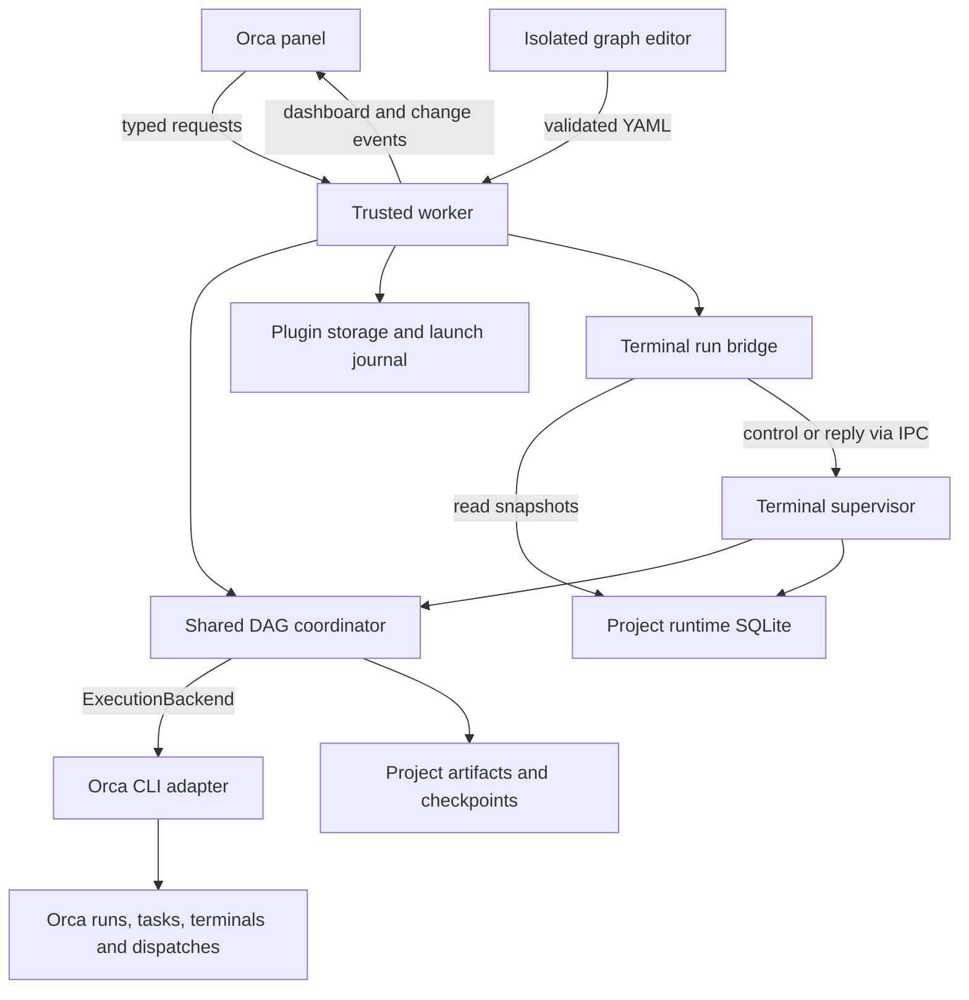

# Agent Pipeline architecture

Agent Pipeline has two execution owners. A run created in the Orca panel belongs to the plugin worker. A run created in the standalone terminal belongs to the terminal runtime. Both use the same scenario format and scheduler. The UI routes each action to the owner that can reconcile its effects.

| Boundary | Implementation | Responsibilities |
| --- | --- | --- |
| Orca components panel | `src/panel.tsx` | Persist project drafts and the run selection, render the wizard and monitor, and dispatch user actions. |
| Isolated editor | `src/graph-editor.ts` | Edit an Orca document session, manipulate graph edges and positions, validate and send the scenario back to the panel. |
| Localization | `src/i18n.ts`, `src/diagnostics.ts` | Translate interface copy and recognized diagnostic formats. Both surfaces read the same Orca plugin setting. YAML and agent output are user data. |
| Plugin worker and requests | `src/worker.ts`, `src/protocol.ts` | Restore history, own the planner and coordinator, receive requests, publish changes, poll active work, and route terminal-owned requests through the bridge. |
| Shared engine | `packages/core/scenario.ts`, `editor.ts`, `coordinator.ts`, `contracts.ts` | Parse and validate YAML, calculate dependencies, apply role and capacity limits, evaluate results and approval gates, and schedule attempts through injected adapters. |
| Host adapters | `src/cli.ts`, `planner.ts`, `model-catalog.ts`, `beads.ts`, `pr.ts`, `usage.ts` | Create and observe native resources, discover model options and account limits, and perform optional tracker or PR operations. |
| Standalone runtime | `packages/runtime/`, `packages/terminal/`, `packages/pi-adapter/` | Run the CLI and supervisor, own worker processes and SQLite records, accept local control messages and support standalone and Orca-backed execution. |

## History, recovery and evidence

The dashboard carries recent snapshots for the quick selector. The archive in `history-view.tsx` calls `history.list` for summaries, then `history.open` for one complete run. The worker merges coordinator and local terminal records in descending creation time and ID order. Both fields form the page cursor. Each terminal lookup verifies the owning workspace path. The bridge continues observing an opened older active run. Dashboard responses are applied only to the current project and request generation.

Recovery maps each pending receipt to its saved run, task or dispatch. An ambiguous receipt stops automatic repair before any run is paused. An attributed repair reconciles the selected run with its native worker before retrying. A failed result is rendered by `result-view.tsx`, which links the recorded check and dispatch. Attempt reports, state files and checkpoints use exclusive private temporary files followed by atomic replacement.

The model adapter intersects observed options with the host launch capabilities. A missing cache, incompatible host and unsupported agent have distinct UI states. New catalog and check diagnostics have typed message IDs. Older records retain their original technical details and translation fallback.

## A single step in flight

1. The panel sends the current YAML and workspace to `run.start`. The worker validates the scenario and placement before creating run resources.
2. The coordinator binds tasks to the run and checks predecessor states, conditions, approvals, capacity and agent availability. The adapter records a mutation request ID so uncertain responses can be reconciled with the host.
3. Polling observes the native attempt. The coordinator records output, checks and artifacts, then schedules newly eligible steps. The worker posts `run.changed` to the panel.
4. On restart, saved history can be inspected while launch reconciliation is pending. A terminal-owned run is read from its project database and remains under its original supervisor’s control.

## Persistent data

| Location | Contents and lifecycle |
| --- | --- |
| Orca settings | Interface language, Beads configuration and polling interval. |
| Panel persisted atoms | Drafts by project, current view and selections. Switching interface language does not rewrite a draft. |
| Worker storage | Run and planner snapshots plus operation receipts. Large JSON snapshots use a generation manifest and chunks. |
| Project `.agent-pipeline/plans/` and `artifacts/` | Plan YAML, attempt outputs, checks and handoffs. Redaction is applied to exported artifact fields. Project history and raw agent output can contain sensitive content. |
| Project `.agent-pipeline/runtime/state.sqlite` | Terminal-owned run state. The bridge opens it read-only for discovery and monitoring. |

The installable Orca artifact is a source directory with a root manifest, production modules, documentation, and the vendored parser. The npm package definition and its standalone runtime bundle serve a separate distribution path. Public plugin tags must be tested using the source tree Orca will actually fetch.
