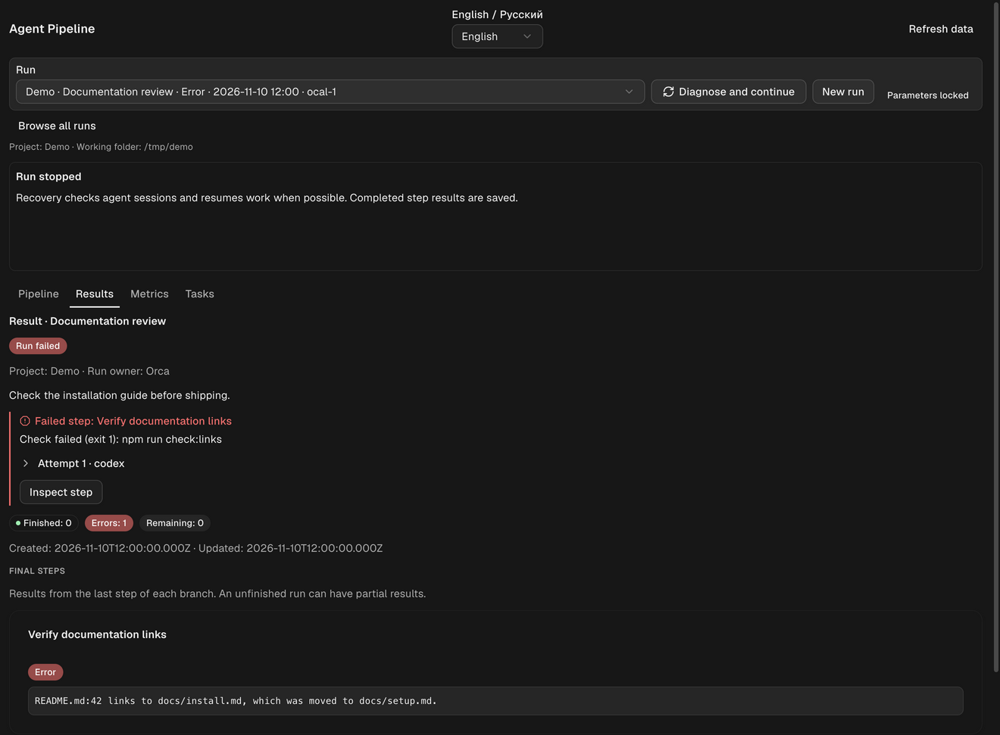

# Agent Pipeline 0.2.1 · Run history, recovery and a standalone terminal

[Русские заметки о выпуске](release-0.2.1.ru.md)

A review finished yesterday. Today you need the exact output, and another run is already in progress. Open **Browse all runs**, filter by project, and select the review. **Results** takes you from a failed check to its exit code and the attempt that produced it. If the attempt belongs to Orca, you can open the original agent session.



## Pick up an interrupted run

Select the run and choose **Diagnose and continue**. Pipeline checks the launch record and existing agent sessions before retrying. Completed steps keep their results. If a launch cannot be attributed to a run, the panel identifies the ambiguity for inspection. The quick selector holds up to 100 recent terminal runs per workspace. **Browse all runs** also reaches older records.

## Take the same YAML to the terminal

The standalone `pipeline` client runs local workflows on macOS and Linux. Detach while agents work, attach again to follow a step, or open the run from the Orca panel. Both interfaces use the same dependency rules. The terminal supervisor owns the runs it starts. The standalone package requires Node.js 22.19 or later and a configured executor.

Version 2 scenarios can branch on a checked output. For example, an audit can return a decision to repair or ship. The scheduler skips the unused branch, and a final review with `join: all_settled` can collect each branch’s outcome. [Worked YAML example](../README.ru.md)

## Plan, preview and review

- Open a team workflow from `pipelines/` under **Project → Repository scenarios**. In **Launch → Run preview**, check the expanded review steps, agent order, working folders and acceptance commands before starting.
- In the graph editor, focus an output with Tab, press Enter, then choose an input and press Enter again. Escape cancels. Focus an existing edge to inspect or remove it.
- The monitor fits a narrow sidebar. Switch between English and Russian at the top of the panel. The model picker explains when the host cannot supply model choices, and keeps the agent default available.

## Upgrade from 0.1.3

On Orca 1.4.263, run the following command and review the access request.

```sh
orca plugin install Alexander-64/orca-pipeline@v0.2.1 --json
```

The plugin keeps its identity, reads earlier run records and opens existing YAML files. This release adds the `workspace:write` grant for workspace operations, including opening the graph editor. The worker runs under your OS account. The built-in task list works on its own. To sync Beads issues, enable **External Beads tracker** in the plugin settings.

The minimum host is Orca 1.4.248. On that version, extract the plugin ZIP and run `orca plugin dev load ./agent-pipeline`. For the standalone client, download the terminal tarball and run `npm install -g ./orca-agent-pipeline-0.2.1.tgz`. `pipeline --help` lists its commands. [Release downloads](https://github.com/Alexander-64/orca-pipeline/releases/tag/v0.2.1)

[English guide](../README.md) · [Русское руководство](../README.ru.md) · [简体中文](../README.zh-CN.md)
