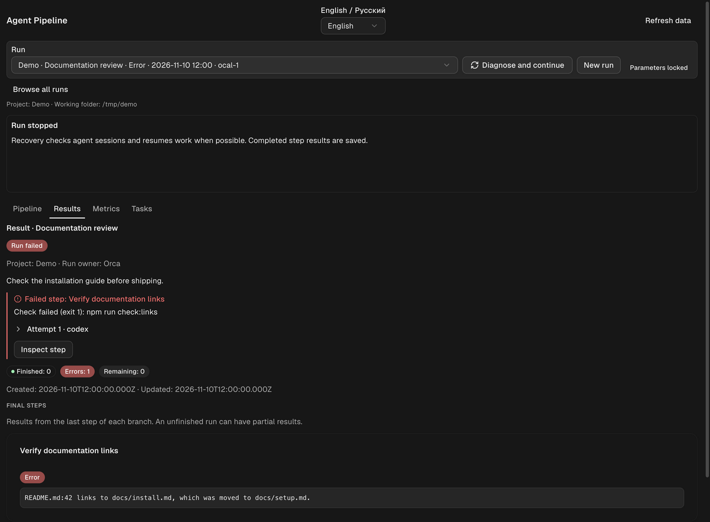

# Agent Pipeline 0.2.1 · История прогонов и самостоятельная консоль

Чтобы найти результат вчерашнего ревью, откройте **Вся история прогонов**, выберите проект и нужный запуск. Во вкладке **Итоги** видны исходная команда проверки, код завершения и попытка, в которой произошла ошибка. Для попытки из Orca можно открыть переписку с агентом.



**После прерывания.** Выберите прогон и нажмите **Разберись и продолжи**. Координатор проверит запись о запуске и уже открытые сессии. Завершённые шаги сохранят результат. Если принадлежность сессии определить нельзя, панель покажет, что нужно проверить вручную.

**Из терминала.** Самостоятельная команда `pipeline` выполняет локальный YAML-сценарий на macOS и Linux. Можно закрыть интерфейс, пока агенты работают, затем подключиться снова или посмотреть результат из Orca. Для консоли нужны Node.js 22.19 или новее и настроенный исполнитель.

**Перед запуском.** Откройте YAML из `pipelines/` через **Проект → Сценарии репозитория**. На этапе запуска раскройте **Предпросмотр запуска**, чтобы проверить агентов, рабочую папку, шаги ревью и команды приёмки. Для связи двух шагов в редакторе перейдите клавишей Tab на выход первого шага, нажмите Enter и повторите на входе второго. Escape отменяет создание связи.

## Обновление с 0.1.3

На Orca 1.4.263 выполните команду и проверьте издателя и права в ответе Orca.

```sh
orca plugin install Alexander-64/orca-pipeline@v0.2.1 --json
```

Плагин использует прежний идентификатор и читает сохранённые сценарии и историю. Появилось право `workspace:write` для операций с рабочими пространствами, включая открытие документов в редакторе. Встроенный список задач доступен сразу. Для синхронизации с Beads включите внешний трекер в настройках плагина.

Для минимальной поддерживаемой Orca 1.4.248 распакуйте ZIP плагина и выполните `orca plugin dev load ./agent-pipeline`. Чтобы установить самостоятельную консоль, скачайте архив `orca-agent-pipeline-0.2.1.tgz` и выполните `npm install -g ./orca-agent-pipeline-0.2.1.tgz`. [Файлы релиза](https://github.com/Alexander-64/orca-pipeline/releases/tag/v0.2.1)

[Руководство](../README.ru.md) · [English release notes](release-0.2.1.md)
