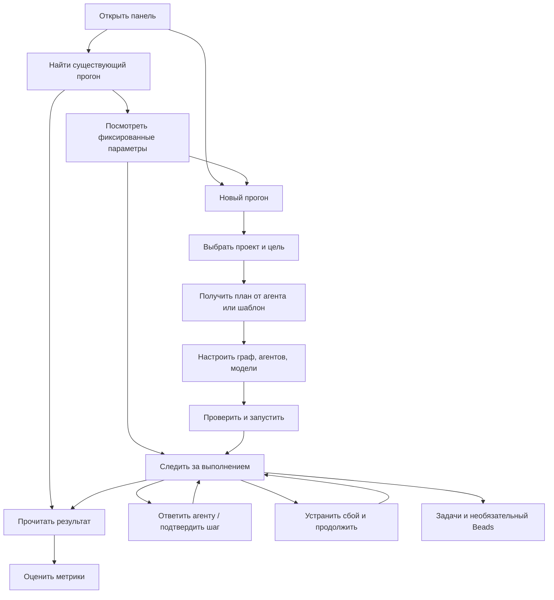

# Agent Pipeline: UX/UI

Цель: пользователь за несколько секунд понимает, какой прогон открыт, что происходит и какое действие нужно дальше. Основная поверхность — нативная components-панель Orca, а не обычный сайт. Сохраняем темы, стандартные компоненты, сценарии и историю. Исследование: 17 ноября 2026.

## Скиллы и применимость

| Источник | Польза | Ограничение / решение |
|---|---|---|
| [Vercel web-design-guidelines](https://github.com/vercel-labs/agent-skills/tree/main/skills/web-design-guidelines), [правила](https://vercel.com/design/guidelines) | понятные ошибки с дальнейшим действием, подписи, устойчивый layout, пустые состояния | HTML/CSS/ARIA принадлежат renderer Orca; применяем правила содержания и семантические компоненты, DOM-аудит отдельно |
| [Impeccable](https://github.com/pbakaus/impeccable) | critique/audit/clarify/distill; режим Operate для рабочих инструментов | изучен как источник методики; не устанавливаем бинарный launcher и не заявляем выполнение его аудита |
| [Anthropic webapp-testing](https://github.com/anthropics/skills/tree/main/skills/webapp-testing) | сначала осмотр состояния, затем действия, снимки и проверка ошибок | Playwright не управляет native components напрямую; используем Orca test kit и реальный renderer |

Применён Vercel web-design-guidelines к src/panel.tsx. Другие скиллы исследованы, их установки и выполнения не было. Никаких npm-команд из интернета не запускали.

## Карта сценариев

## Оценка вариантов до реализации

Это отдельная критическая оценка автором, без независимого второго эксперта и без пользовательского исследования. Баллы — гипотеза. Шкалы: польза и уверенность 1–5, стоимость 1–5; рейтинг = польза × уверенность / стоимость. При равенстве сначала предотвращение ошибок.

| Вариант | Польза | Уверенность | Стоимость | Рейтинг | Контраргумент / решение |
|---|---:|---:|---:|---:|---|
| A: единое понятное восстановление, исключить тупиковую «Продолжить» | 5 | 5 | 2 | 12.5 | глобальная проблема может относиться к другому прогону; предупреждение явно говорит о журнале исполнителя. В топ |
| B: честный прогресс: успех отдельно от ошибок и пропусков | 5 | 5 | 2 | 12.5 | доля успехов не отражает объём оставшейся работы; показываем точные счётчики. В топ |
| C: проект в истории + контекст выбранной рабочей папки | 4 | 5 | 2 | 10 | длиннее варианты select; оставляем короткое имя папки, полный путь отдельно. В топ |
| Копировать старый прогон в новый черновик | 4 | 4 | 3 | 5.3 | может затереть текущий черновик; отложено до истории черновиков |
| Zoomable canvas вместо списка волн | 4 | 3 | 5 | 2.4 | высокая цена, хуже keyboard и узкая панель; текущие волны уже показывают DAG. Отложено |
| Полный редизайн цветов и анимации | 2 | 2 | 4 | 1 | не решает наблюдавшиеся затруднения. Не делать |
| Поиск/фильтры тысяч прогонов | 3 | 3 | 3 | 3 | пока 17 прогонов; добавлять после измерения объёма |

## План и границы

1. Зафиксировать сценарии и e2e-кейсы (cases.md), сопоставить с автоматизацией.
2. A: восстановление: объяснение причины, один путь исправления, блок обычного resume/retry при неизвестном запуске. Прогнать регрессию.
3. B: статус и счётчики успехов/ошибок/пропусков. Прогнать всю регрессию снова.
4. C: история с проектом и выбранным путём. Прогнать всю регрессию снова.
5. Typecheck, render/check, узкая и широкая панель, стабильная установленная сборка, открыть пользователю.

Реальные платные вызовы LLM не нужны для UX-регрессии: запуск и ответы проверяются через контракт хоста. Это интеграционные UI-тесты, а не полное e2e с живым агентом. Полные ручные e2e описаны отдельно; их нельзя объявлять прошедшими только по mount-тестам. Журнал прогонов: validation.md.
